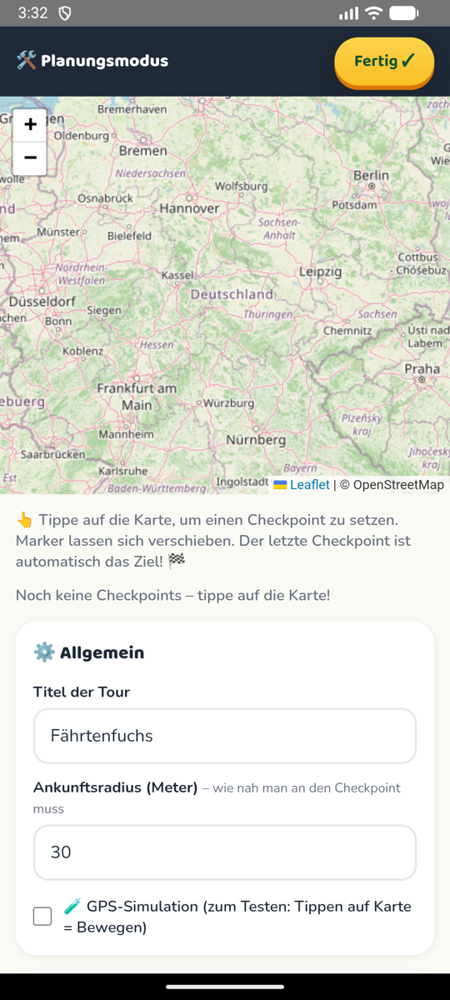

# Fährtenfuchs 🦊

**Schnitzeljagd mit Rad oder zu Fuß fürs Handy** – z. B. für den Kindergeburtstag: Route mit Checkpoints auf der Karte planen,
unterwegs Rätsel lösen, am Ende ein Fotobuch. Läuft komplett auf dem Gerät – kein Backend, kein Konto, Route, Spielstand
und Fotos bleiben lokal.
*A bike/walking scavenger hunt for kids' parties – plan checkpoints on a map, solve riddles on the way, get a photo book at the end. Runs fully on the device.*

<p>
  
  
</p>

- `www/` – die App (HTML/CSS/JS, Karte über OpenStreetMap/Leaflet, Routen vom FOSSGIS-OSM-Routing, kein API-Key)
- `android/` – Android-Hülle mit [Capacitor](https://capacitorjs.com/) (`de.faehrtenfuchs.app`)
- `assets/` – App-Symbol und Splash
- Community-Routen: [faehrtenfuchs-routen](https://github.com/Arno-Hoefer/faehrtenfuchs-routen)

## Bauen

```bash
npm install
npx cap sync android
cd android && ./gradlew assembleDebug
```

Als Web-App reicht ein statischer Host mit HTTPS (GPS und Kamera brauchen HTTPS), z. B. `www/` auf Netlify oder GitHub Pages.

## Bedienung

- **Planungsmodus:** auf der Startseite 5× auf den Fuchs tippen → auf die Karte tippen setzt Checkpoints (Name, Rätsel, Antwort, Tipp);
  der letzte Checkpoint ist der Schatz. Route als JSON exportieren/importieren.
- **Spiel:** Karte mit Position, Linie und Entfernung zum nächsten Checkpoint; im Zielradius öffnet sich das Rätsel, danach das Foto.
- **Fotobuch:** nach dem Finale – Cover mit gefahrener Route, pro Checkpoint Foto, Rätsel und Uhrzeit, als PDF druckbar.
- **GPS-Simulation** im Planungsmodus zum Testen vom Sofa aus.

## Lizenz

MIT – siehe [LICENSE](LICENSE). Karten © [OpenStreetMap](https://www.openstreetmap.org/copyright)-Mitwirkende, [Leaflet](https://leafletjs.com) (BSD-2).
